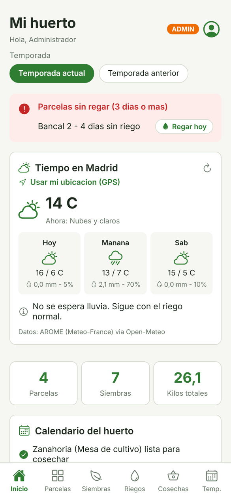
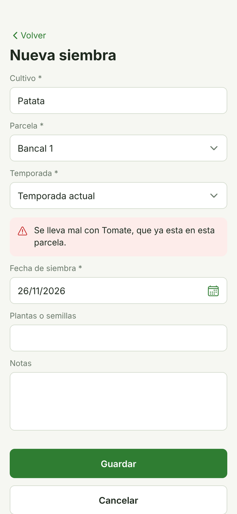
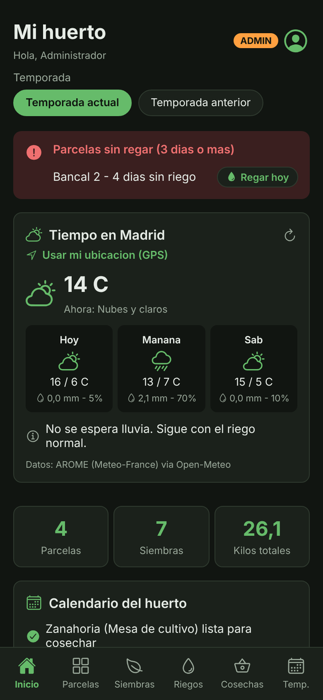
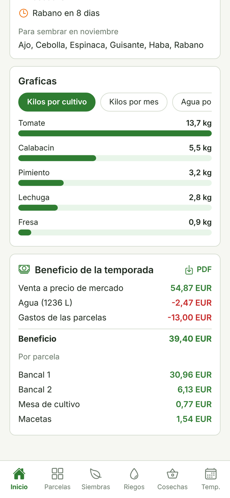
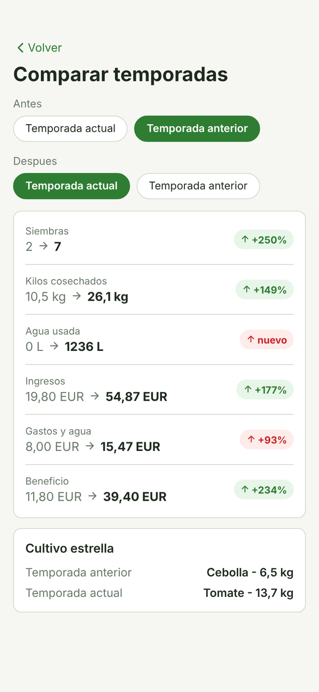
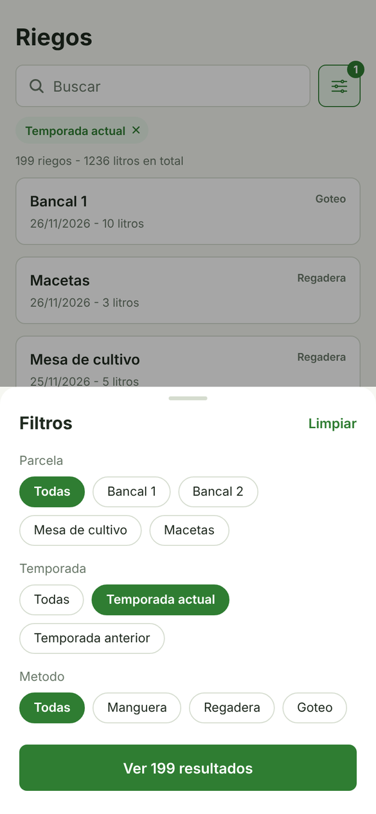
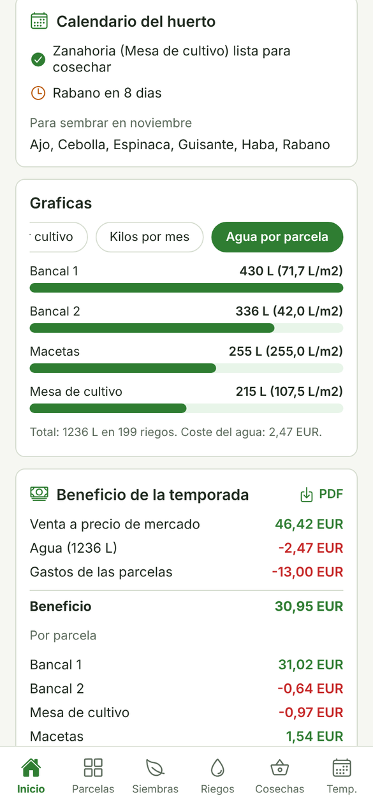
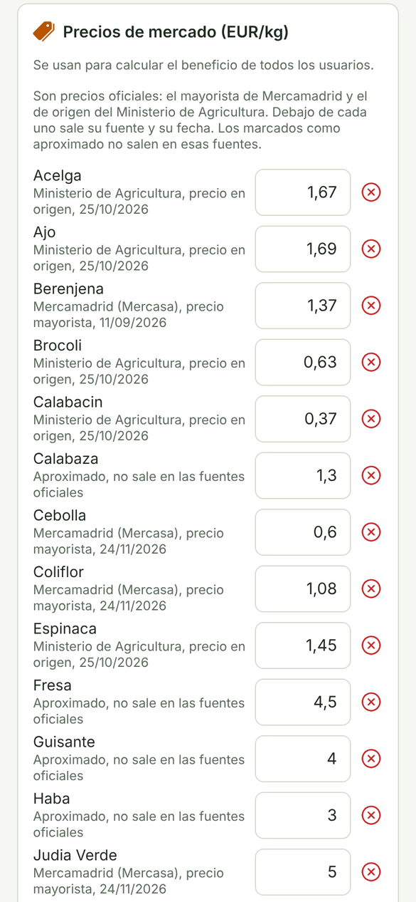
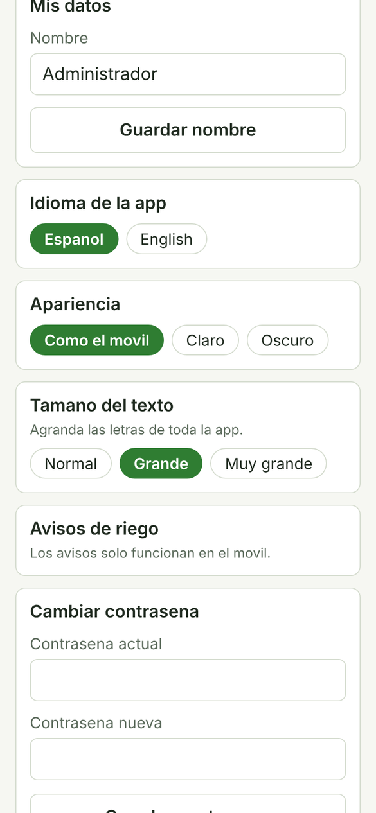
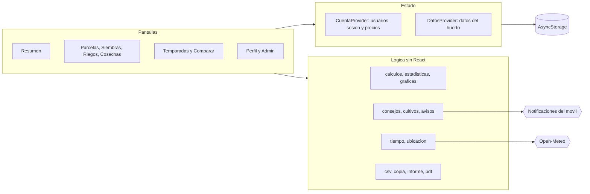

# Huerto Urbano

App multiplataforma para gestionar un huerto urbano: parcelas, siembras, riegos y cosechas organizadas por temporadas, con prevision del tiempo, calendario de cultivos y calculo del beneficio de cada temporada.

Proyecto final de 2 DAM. Hecha con React Native y Expo: un solo codigo para Android, iOS y web (escritorio desde el navegador).

Quien tiene un huerto en una terraza, un patio o un huerto municipal suele apuntarlo todo en una libreta o no apuntarlo: cuando riega, que planto en cada bancal la temporada pasada o si de verdad le sale a cuenta. Huerto Urbano junta todo eso en el movil, avisa cuando toca regar (y no avisa si ya ha llovido), da consejos al sembrar y calcula cuanto has ganado con precios reales de mercado.

[](https://github.com/RaulGalera/huerto-urbano/actions/workflows/tests.yml)


<p align="center">
  
  
  
</p>

## Indice

- [Prueba rapida](#prueba-rapida)
- [Funcionalidades](#funcionalidades)
- [Capturas](#capturas)
- [Fuentes de datos](#fuentes-de-datos)
- [Tecnologias](#tecnologias)
- [Puesta en marcha](#puesta-en-marcha)
- [Scripts](#scripts)
- [Tests](#tests)
- [Arquitectura](#arquitectura)
- [Modelo de datos](#modelo-de-datos)
- [Calculo del beneficio](#calculo-del-beneficio)
- [Idiomas](#idiomas)
- [Privacidad, ley y accesibilidad](#privacidad-ley-y-accesibilidad)
- [Seguridad](#seguridad)
- [Hoja de ruta](#hoja-de-ruta)
- [Convenciones del proyecto](#convenciones-del-proyecto)

## Prueba rapida

1. Arranca la app (ver [Puesta en marcha](#puesta-en-marcha)).
2. Entra con el usuario `admin` y la contrasena `admin123`.
3. En Mi cuenta pulsa "Cargar datos de ejemplo": se crea un huerto con dos temporadas, cuatro parcelas, siembras, riegos y cosechas.

## Funcionalidades

Gestion del huerto

- Temporadas con fecha de inicio y fin. Cada temporada muestra sus siembras, kilos y beneficio, y una pantalla compara dos temporadas: siembras, kilos, agua, ingresos, gastos, beneficio y cultivo estrella, con el cambio en porcentaje.
- Parcelas con superficie, ubicacion, gastos por temporada y estado del riego.
- Siembras con cultivo, parcela, temporada, fecha y cantidad. Fecha de cosecha estimada segun el cultivo.
- Al sembrar avisa de la rotacion de cultivos (si en esa parcela hubo la misma familia la temporada anterior) y de las plantas amigas y enemigas que ya hay en la parcela.
- Riegos con litros y metodo (manguera, regadera o goteo). Si llueve 5 mm o mas cuenta como riego en las parcelas al aire libre.
- Cosechas con kilos por siembra.
- Buscador en todas las listas (sin distinguir mayusculas ni tildes) y panel de filtros combinables por temporada, parcela, verdura y metodo de riego, con los filtros activos visibles y faciles de quitar.

Pantalla de inicio

- Aviso de parcelas sin regar desde hace 3 dias o mas, con boton "Regar hoy".
- Tiempo de los proximos 3 dias con Open-Meteo y consejo de riego (lluvia, calor o helada).
- Calendario del huerto: siembras listas para cosechar, proximas cosechas y que sembrar este mes.
- Graficas: kilos por cultivo y por mes, agua por parcela (con litros por m2) y por mes, con el total y lo que cuesta el agua, y beneficio por temporada.
- Beneficio de la temporada, total y por parcela, descargable en PDF.

Cuentas

- Registro e inicio de sesion locales. Cada usuario ve solo sus datos.
- Guia de bienvenida de tres pasos la primera vez que se entra.
- Idioma elegible al registrarse (espanol por defecto o ingles) y cambiable despues.
- Modo oscuro: como el movil, claro u oscuro.
- Tamano del texto: normal, grande o muy grande, para toda la app.
- Avisos de riego en el movil: si una parcela lleva 3 dias o mas sin regar te llega una notificacion a las 9:00. Se activan en Mi cuenta y tienen un boton para probarlos.
- Mi cuenta: cambiar nombre, contrasena, idioma, apariencia, tamano del texto, avisos y ubicacion, exportar siembras, riegos y cosechas a Excel (CSV), copia de seguridad (exportar y restaurar), privacidad y borrar la cuenta.

Modo admin

- Estadisticas de toda la app.
- Precios de mercado reales por cultivo (Mercamadrid y Ministerio de Agricultura, con fuente y fecha), precio del agua y porcentaje de impuestos.
- Gestion de usuarios (dar o quitar admin, borrar).
- Cargar un huerto de ejemplo para hacer demostraciones.

## Capturas

| Inicio | Graficas y beneficio | Comparar temporadas |
| :---: | :---: | :---: |
|  |  |  |
| **Nueva siembra con consejos** | **Filtros** | **Modo oscuro** |
|  |  |  |
| **Agua por parcela y coste** | **Precios reales con su fuente** | **Tamano del texto** |
|  |  |  |

## Fuentes de datos

| Dato | Fuente | Como se usa |
| --- | --- | --- |
| Tiempo y lluvia | [Open-Meteo](https://open-meteo.com/) (modelo AROME de Meteo-France) | Prevision de 3 dias y lluvia de los 3 dias anteriores. Gratis, sin clave y solo recibe coordenadas. |
| Precios mayoristas | [Mercasa](https://www.mercasa.es/precios-y-mercados-mayoristas/) (Mercamadrid) | Tomate, lechuga, pimiento, cebolla, patata, judia verde, coliflor, berenjena y sandia. |
| Precios en origen | [Ministerio de Agricultura](https://www.mapa.gob.es/es/agricultura/temas/producciones-agricolas/frutas-y-hortalizas/boletin_semanal_precios.aspx) (informe semanal de coyuntura) | Calabacin, zanahoria, pepino, espinaca, acelga, ajo, brocoli, puerro y melon. |
| Calendario de cultivos | Datos propios en `src/cultivos.js` | Dias hasta la cosecha, meses de siembra y familia de cada cultivo. |

Ninguna fuente de precios tiene API, asi que los precios van dentro de la app con su fuente y su fecha (`src/precios.js`) y el admin los puede cambiar. Fresa, calabaza, haba, guisante y rabano no salen en esas fuentes y estan marcados como aproximados. La lechuga va por unidad, como la publica Mercamadrid.

## Tecnologias

| Area | Tecnologia |
| --- | --- |
| Framework | React Native 0.88 con Expo SDK 58 |
| Lenguaje | JavaScript (React 19, hooks y Context) |
| Persistencia | AsyncStorage (localStorage en web) |
| Tiempo | API de Open-Meteo, modelo AROME de Meteo-France (gratis y sin clave) |
| Ubicacion | expo-location |
| Iconos | @expo/vector-icons (Ionicons) |
| PDF | expo-print y expo-sharing |
| Avisos | expo-notifications (notificaciones locales) |
| Zona segura | react-native-safe-area-context |
| Tests | Jest con jest-expo y Testing Library |
| Pruebas de principio a fin | Playwright (en la version web) |

No usa librerias de navegacion: las pestanas y los modales estan hechos a mano para que la app sea ligera y facil de seguir.

## Puesta en marcha

Requisitos: Node.js 22 (ver `.nvmrc`) y la app Expo Go en el movil (o Android Studio con un emulador).

```bash
git clone https://github.com/RaulGalera/huerto-urbano.git
cd huerto-urbano
npm install
npx expo start
```

- Movil por Wi-Fi: escanear el QR con Expo Go.
- Movil por cable: `adb reverse tcp:8081 tcp:8081` y abrir `exp://127.0.0.1:8081` en Expo Go.
- Web o escritorio: pulsar `w` en la terminal o ejecutar `npm run web`.

La primera vez se crea un administrador: usuario `admin`, contrasena `admin123`. Hay que cambiarla desde Mi cuenta.

## Scripts

| Comando | Que hace |
| --- | --- |
| `npm start` | Arranca Expo |
| `npm run android` | Abre la app en Android |
| `npm run ios` | Abre la app en iOS |
| `npm run web` | Abre la app en el navegador |
| `npm test` | Ejecuta los tests |
| `npm run e2e` | Genera la version web y lanza las pruebas de principio a fin |

## Tests

```bash
npm test
```

GitHub Actions ejecuta los tests y las pruebas de principio a fin en cada push y en cada pull request (`.github/workflows/tests.yml`).

89 tests en `__tests__/` que cubren: pantallas (bienvenida, graficas, filtros, comparar temporadas, login, registro y avisos de riego) con Testing Library, avisos de riego programados, informe PDF, calculo del beneficio, precios reales con su fuente, fechas y utilidades, calendario de cultivos, consejo de riego y prevision combinada, contrasenas con sal, SHA-256, copia de seguridad, buscador, filtros, graficas de kilos y de agua, datos de ejemplo, rotacion y plantas amigas, lluvia como riego, exportar a CSV y accesibilidad (contraste de colores, tamano del texto y botones con rol para lectores de pantalla).

### Pruebas de principio a fin

```bash
npx playwright install chromium
npm run e2e
```

Estan en `e2e/`. Abren la version web en un navegador con tamano de movil y usan la app como una persona, buscando los botones y campos por su nombre accesible:

- El admin entra y ve el inicio.
- No deja entrar con una contrasena mala.
- Un usuario nuevo se registra, crea una parcela y la riega desde el inicio.
- La grafica de agua por mes muestra el total, el coste y los litros por m2.
- El texto de la app se puede agrandar.
- La app se puede cambiar a ingles.

## Arquitectura

```
App.js                    Sesion, idioma, pestanas y navegacion
src/
  cuenta.js               Usuarios, sesion, config de precios, borrado de cuenta
  datos.js                Datos de cada usuario (guardar, borrar, reemplazar)
  claves.js               Contrasenas con sal y migracion de las antiguas
  sha256.js               SHA-256 en JavaScript para las contrasenas
  calculos.js             Beneficio por temporada y por parcela
  estadisticas.js         Resumen y comparacion de temporadas
  graficas.js             Datos de las graficas del inicio
  informe.js              HTML del balance para el PDF
  pdf.js                  Crear y abrir el PDF
  ejemplo.js              Huerto de ejemplo para demostraciones
  precios.js              Precios de mercado reales con su fuente y fecha
  cultivos.js             Dias hasta cosecha, meses de siembra y familia
  consejos.js             Rotacion de cultivos y plantas amigas y enemigas
  csv.js                  Exportar siembras, riegos y cosechas a CSV
  archivos.js             Descargar o compartir archivos
  tiempo.js               Prevision de Open-Meteo, lluvia de los ultimos dias y consejo de riego
  ubicacion.js            GPS con expo-location
  copia.js                Exportar y restaurar datos, filtro del buscador
  avisos.js               Avisos de riego programados en el movil
  idioma.js               Textos en espanol e ingles
  legal.js                Privacidad, aviso legal, condiciones, accesibilidad
  util.js                 Fechas, numeros y ayudas varias
  componentes/            ListaEditable, Formulario, Filtros, Chips, Casilla, SelectorFecha,
                          Tiempo, Graficas, Bienvenida
  pantallas/              Resumen, Parcelas, Siembras, Riegos, Cosechas, Temporadas,
                          Comparar, Login, Perfil, Admin, Legal
__tests__/                Tests de Jest
e2e/                      Pruebas de principio a fin con Playwright
docs/                     Documentacion (cumplimiento legal) y capturas
.github/workflows/        Tests automaticos con GitHub Actions
```

El estado se reparte en dos Context de React:

- `CuentaProvider` (src/cuenta.js): lista de usuarios, sesion activa y configuracion global de precios.
- `DatosProvider` (src/datos.js): datos del huerto del usuario con sesion, guardados con la clave `huerto_datos_<idUsuario>`.



La logica que se puede probar (calculos, fechas, tiempo, claves, copia) esta en modulos sin React, separada de las pantallas.

## Modelo de datos

```
Usuario     id, usuario, nombre, clave, sal, v, rol (admin | usuario), idioma, tema, texto, avisos, bienvenida, creado, legal
Temporada   id, nombre, inicio, fin
Parcela     id, nombre, metros, ubicacion, aireLibre (si | no), gastos, notas
Siembra     id, cultivo, parcelaId, temporadaId, fecha, cantidad, notas
Riego       id, parcelaId, fecha, litros, metodo
Cosecha     id, siembraId, fecha, kilos, notas
Ajustes     ciudad (nombre, latitud, longitud), lluvias (mm por dia, ultimos 30 dias)
Config      precios (EUR/kg por cultivo), versionPrecios, precioAgua (EUR/m3), impuestos (%)
```

Las fechas se guardan en ISO (AAAA-MM-DD) y se muestran como DD/MM/AAAA. Al borrar una parcela, siembra o temporada se borra en cascada lo que depende de ella.

## Calculo del beneficio

```
beneficio = kilos x precio de mercado
          - litros / 1000 x precio del agua
          - gastos de las parcelas usadas en la temporada
          - impuestos (porcentaje sobre el beneficio positivo)
```

Esta en `src/calculos.js`. Los precios de mercado son reales (ver [Fuentes de datos](#fuentes-de-datos)) y el administrador los puede cambiar. Si cambian los precios de la app, los que el admin no habia tocado se actualizan solos.

## Idiomas

Espanol (por defecto) e ingles. Los textos estan en `src/idioma.js`: la clave es el texto en espanol y la traduccion va en el bloque `en`. Para anadir un idioma basta con anadir un bloque nuevo y su entrada en `IDIOMAS`. Si falta una traduccion se ve el texto en espanol.

## Privacidad, ley y accesibilidad

La app esta pensada para cumplir el RGPD, la LOPDGDD, la LSSI, la Ley 11/2023 de accesibilidad y las normas de Google Play:

- Edad minima de 14 anos y aceptacion de la politica de privacidad al registrarse, guardando version y fecha.
- Politica de privacidad, aviso legal, condiciones y accesibilidad dentro de la app, a dos toques como mucho.
- Derechos del usuario desde la app: ver, corregir, exportar y borrar sus datos.
- El GPS solo se pide cuando el usuario pulsa el boton.
- Sin publicidad, sin analitica y sin SDK de terceros.
- Accesibilidad (WCAG 2.1 AA):
  - Todos los botones tienen rol y nombre para lectores de pantalla (TalkBack, VoiceOver), las pestanas y opciones dicen cual esta elegida y los titulos se anuncian como encabezados.
  - Todos los campos de texto tienen etiqueta.
  - Contraste de colores de 4,5:1 o mas en el tema claro y en el oscuro, comprobado con un test.
  - Tamano del texto ajustable en Mi cuenta, ademas de respetar el tamano de letra del movil.

El detalle y lo que tiene que cumplir el servidor esta en [docs/cumplimiento-legal.md](docs/cumplimiento-legal.md). Para publicar en Google Play falta una pagina web para pedir el borrado de la cuenta; de momento se pide por email.

## Seguridad

- Contrasenas con sal aleatoria de 16 bytes y 2000 vueltas de SHA-256. Las cuentas con el formato antiguo se migran solas al iniciar sesion.
- El repositorio no contiene claves ni secretos. Los ficheros `.env` estan en `.gitignore`.
- Open-Meteo no necesita clave y solo recibe coordenadas, nunca datos del usuario.

## Hoja de ruta

Hecho

- [x] Parcelas, siembras, riegos, cosechas y temporadas con buscador y filtros.
- [x] Tiempo, lluvia como riego y avisos de riego en el movil.
- [x] Calendario de cultivos, rotacion y plantas amigas.
- [x] Beneficio con precios reales, PDF y comparar temporadas.
- [x] Espanol e ingles, modo oscuro, tamano del texto y accesibilidad.
- [x] Tests, pruebas de principio a fin y GitHub Actions.

Pendiente

- [ ] API REST en AWS (region de la UE) para sincronizar los datos entre dispositivos, con HTTPS, datos cifrados, autenticacion con token y endpoints para exportar y borrar la cuenta. Los requisitos estan en `docs/cumplimiento-legal.md`.
- [ ] Formulas de beneficio definitivas.
- [ ] APK instalable sin Expo Go.
- [ ] Fotos en siembras y cosechas.
- [ ] Recordatorio de siembra segun el calendario de cultivos.

## Convenciones del proyecto

- Codigo en espanol, sin comentarios, sin acentos ni caracteres especiales en codigo y textos de la app.
- Un commit por cada mejora, con mensaje corto en espanol.
- Antes de subir: `npm test` tiene que pasar entero, y `npm run e2e` si se tocan pantallas.
- Los cambios de cada version se apuntan en [CHANGELOG.md](CHANGELOG.md).
